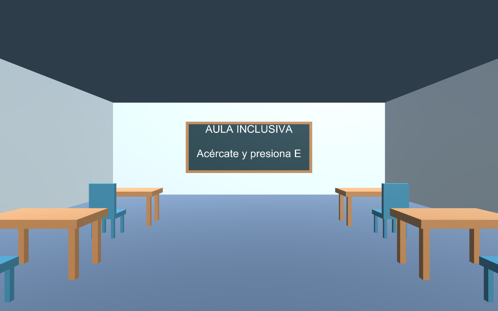

# Validación — Aula Inclusiva 3D

Fecha: 16 de noviembre de 2026 (America/Guayaquil).
Entorno: Windows, Unity 6.0 LTS `6000.0.80f1`.

## Repositorio

Se revisó el commit inicial `a622a1f`: solo contenía `.gitignore`, que se conservó sin modificaciones. El proyecto se añadió en la raíz en una rama independiente.

## Ejecución real en Unity

La generación de escena terminó con código de salida 0 y `AULA_GENERATED`.
La prueba se ejecutó en Play Mode mediante `ClassroomProject.SmokeTest`, en batchmode sin gráficos. Terminó con código 0 y `AULA_SMOKE_TEST_PASSED`.

| Comprobación | Resultado |
| --- | --- |
| Existe exactamente una pizarra interactiva | PASS |
| No se puede interactuar desde el punto inicial | PASS |
| El CharacterController se desplaza hacia adelante | PASS |
| El raycast alcanza la pizarra a distancia de lectura | PASS |
| La interacción abre la lectura y activa el estado de pausa de navegación | PASS |
| Se puede llegar a la tercera página | PASS |
| Una respuesta incorrecta permite reintentar | PASS |
| La respuesta correcta completa la actividad | PASS |
| Cerrar restaura el estado de navegación | PASS |
| La colisión de la pizarra impide atravesarla | PASS |

Las comprobaciones llaman a los mismos métodos usados por el flujo de juego; no inyectan pulsaciones físicas de teclado o clics.

## Vista del aula

Se generó `Aula.png` renderizando la cámara real de la escena a 1280 × 800. Se inspeccionó visualmente: muebles presentes, pasillo central libre y texto de la pizarra orientado y legible. Esta captura contiene solo la escena 3D, sin la interfaz IMGUI.



## Límites

La prueba automática sin gráficos no evalúa la distribución de la interfaz, la sensibilidad del ratón ni la interacción mediante dispositivos físicos. No se han realizado pruebas con personas sordas o con discapacidad auditiva. Antes de la exposición se recomienda ejecutar el guion del README en el equipo y pantalla que se utilizarán.

## Compilación Windows

`ClassroomProject.PreviewAndBuild` completó la compilación Windows x86_64 con resultado `Succeeded`, código de salida 0 y `AULA_WINDOWS_BUILD_PASSED`. El ejecutable y sus dependencias se generan en `Builds/AulaInclusiva3D` y se excluyen del control de versiones. Se verificó la compilación; el ejecutable independiente no fue probado manualmente.

Para repetir la generación de captura y compilación (reemplaza la escena y los modelos de escena, conserva los OBJ), ejecuta con el editor cerrado:

```powershell
& 'C:\Program Files\Unity\Hub\Editor\6000.0.80f1\Editor\Unity.exe' -batchmode -buildTarget Win64 -projectPath 'C:\ruta\al\repositorio' -executeMethod ClassroomProject.PreviewAndBuild -quit -logFile 'C:\ruta\build.log'
```
