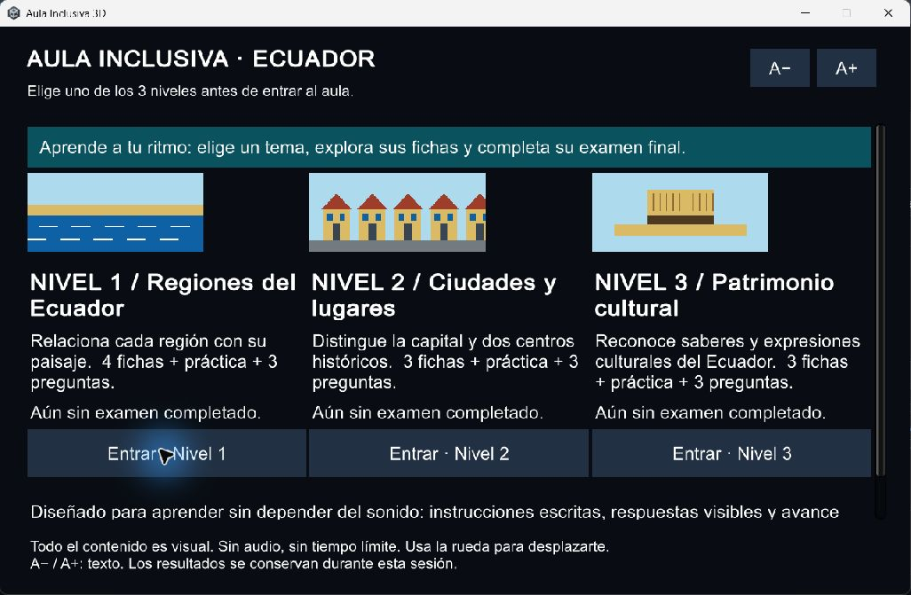

# Aula Inclusiva 3D · Ecuador

Prototipo universitario del Grupo 7 para aprender cultura general ecuatoriana sin depender del audio. Incluye **exactamente tres niveles**, selección de tema antes de entrar al aula, fichas ilustradas interactivas y un examen final por nivel.

## Abrir y ejecutar

1. Instala **Unity 6.0 LTS 6000.0.80f1** con Unity Hub.
2. Clona el repositorio. En Hub selecciona **Add > Add project from disk** y elige la raíz que contiene `Assets`, `Packages` y `ProjectSettings`.
3. Espera la importación, abre `Assets/Scenes/AulaInclusiva.unity` y pulsa **Play**.
4. En el menú, elige uno de los tres temas. El movimiento permanece bloqueado hasta elegirlo.
5. Camina por el pasillo central, acércate a la pizarra y presiona **E** cuando aparezca el aviso.
6. Explora todas las fichas de la clase y responde correctamente la práctica para habilitar el examen. La práctica permite reintentos y no suma puntos.
7. En el examen selecciona una respuesta y pulsa **Confirmar respuesta**. Lee la explicación y avanza manualmente. Al final verás tu score, porcentaje y revisión de respuestas.
8. Repite el examen, repasa la clase o vuelve al menú para elegir otro tema.

La escena ya está guardada con sus referencias y añadida a compilación. Usa el renderizador integrado y la entrada clásica; no requiere paquetes de terceros ni servicios externos.

## Los tres niveles

| Nivel | Clase interactiva | Examen final |
| --- | --- | --- |
| 1. Regiones del Ecuador | Costa, Sierra, Amazonía e Insular; fichas con paisajes esquemáticos | 3 preguntas |
| 2. Ciudades y lugares | Quito, Cuenca y Galápagos; capital y tipos de patrimonio | 3 preguntas |
| 3. Patrimonio cultural | Paja toquilla, pasillo y cuidado de los saberes culturales | 3 preguntas |

Cada pregunta vale **1 punto**: máximo **3/3**, equivalente al **100 %**. Las respuestas se confirman una sola vez y no se pueden saltar preguntas. El resultado incluye la respuesta elegida, la correcta y una explicación. Repetir reinicia el score actual; el mejor resultado de cada nivel se conserva en el menú **durante la sesión**, incluso al cambiar de tema. Cerrar la aplicación borra ese registro. Volver al menú durante un examen descarta el intento sin terminar; al entrar a un nivel se empieza una clase nueva.

## Controles y accesibilidad visual

| Acción | Control |
| --- | --- |
| Caminar / mirar | WASD / ratón |
| Abrir clase / volver al aula | E |
| Cerrar lectura / liberar cursor | Esc |
| Elegir otro nivel | M o botón Volver al menú |
| Recuperar control de cámara | Clic en Game fuera de la lectura |
| Explorar fichas / responder / confirmar | Botones con ratón |
| Desplazarse por contenido | Rueda o barra de desplazamiento |
| Ajustar texto | A− / A+ (22–32) |

- Panel de lectura **completamente opaco y oscuro**: el texto 3D de la pizarra no se transparenta.
- Texto claro, botones grandes, ilustraciones esquemáticas con descripción escrita y estados nombrados (no dependen solo del color).
- Sin audio, cronómetro ni avance automático. Todas las instrucciones, respuestas y explicaciones son visibles.
- La lectura pausa el desplazamiento y libera el cursor. El contenido se puede desplazar con texto grande.
- Resolución recomendada: 1280 × 800 o superior. La interfaz escala en pantallas menores.

El prototipo está orientado a estudiantes sordos o con discapacidad auditiva. **No incluye traducción a lengua de señas ecuatoriana** ni afirma que el texto cubra las preferencias de todas las personas sordas. No enseña señas. Las ilustraciones son recursos esquemáticos originales, no mapas ni representaciones de señas. Se requiere evaluación con estudiantes y docentes de la comunidad sorda antes de afirmar accesibilidad validada.

## Archivos principales

- `Assets/Scenes/AulaInclusiva.unity`: aula con piso, paredes, seis mesas, seis sillas y pizarra.
- `Assets/Scripts/FirstPersonController.cs`: WASD, cámara, gravedad, cursor y posición inicial.
- `Assets/Scripts/ClassroomLesson.cs`: menú, fichas, práctica, exámenes, score y panel opaco.
- `Assets/Scripts/EcuadorContent.cs`: contenido editable de los tres niveles y nueve preguntas.
- `Assets/Scripts/LearningIllustrations.cs`: dibujos esquemáticos generados en Unity, sin descargar imágenes.
- `Assets/Scripts/Blackboard.cs`: identifica la pizarra interactiva.
- `Assets/Editor/ClassroomProject.cs`: genera la escena, compila para Windows y ejecuta pruebas de Play Mode.
- `Documentation/FUENTES.md`: fuentes oficiales y alcance del contenido educativo.
- `Documentation/VALIDACION.md` y `RESULTADOS.txt`: pruebas realizadas y limitaciones.

## Blender y modelos

En Blender usa **File > Import > Wavefront (.obj)** para abrir `Assets/Models/Mesa.obj` y `Silla.obj`. Son modelos originales en metros y se usan en la escena; los colores se asignan con materiales de Unity. Piso, paredes y pizarra usan cubos nativos.

`python Tools/generate_models.py` regenera y reemplaza ambos OBJ. El menú de Unity **Aula Inclusiva > Regenerar escena** reemplaza la escena del prototipo; guarda una copia antes si la editaste manualmente.

## Pruebas y compilación

Con el editor cerrado, ajusta las rutas y ejecuta:

```powershell
& 'C:\Program Files\Unity\Hub\Editor\6000.0.80f1\Editor\Unity.exe' -batchmode -nographics -projectPath 'C:\ruta\al\repositorio' -executeMethod ClassroomProject.SmokeTest -logFile 'C:\ruta\smoke.log'
```

No agregues `-quit`: el método entra en Play Mode y sale con código 0 si pasa, 1 si falla. Busca `AULA_SMOKE_TEST_PASSED`. La prueba cubre los tres niveles, desbloqueo de examen, resultados perfectos y de cero puntos, reinicio y protección ante puntuación duplicada, además del movimiento e interacción.

Para generar un ejecutable: **File > Build Profiles > Windows > Build** con la escena `AulaInclusiva` incluida. O ejecuta:

```powershell
& 'C:\Program Files\Unity\Hub\Editor\6000.0.80f1\Editor\Unity.exe' -batchmode -buildTarget Win64 -projectPath 'C:\ruta\al\repositorio' -executeMethod ClassroomProject.PreviewAndBuild -quit -logFile 'C:\ruta\build.log'
```

Este último comando regenera la escena, guarda la vista 3D `Documentation/Aula.png` y compila en `Builds/AulaInclusiva3D`. Para distribuir la aplicación conserva el `.exe` junto con todas sus carpetas y DLL; no copies solo el ejecutable.

## Presentación universitaria

Muestra los tres temas en el menú, entra en uno, camina a la pizarra, explora las fichas y aumenta el texto. Resuelve la práctica, completa el examen y muestra el score y la revisión. Vuelve al menú para mostrar el mejor resultado y elegir otro nivel. Toda la demostración puede hacerse sin sonido.


